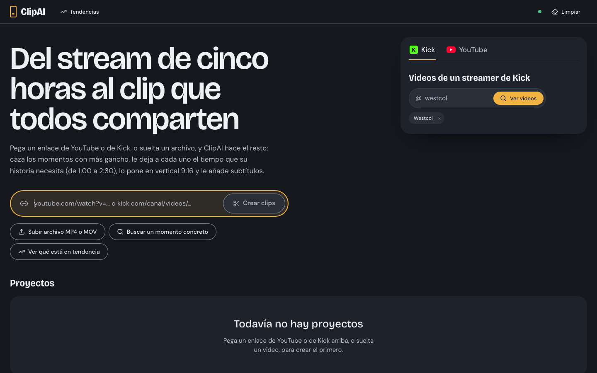

# ClipAI

**ClipAI convierte videos largos (podcasts, entrevistas, streams) en clips verticales 9:16 listos para TikTok, Instagram Reels y YouTube Shorts.** Corre en tu propia computadora (con un solo comando de Docker): pegas un enlace o subes un video, la IA elige los momentos más fuertes y te entrega cada clip con subtítulos animados, texto gancho, portada, título, descripción y hashtags.

- **Local y privado:** la app, la base de datos y tus videos viven en tu máquina (`127.0.0.1`). Sin cuentas, sin nube propia, sin suscripción. Solo salen a internet la descarga del video, la consulta a la IA (si la activas) y, si la configuras, la publicación.
- **Cada clip dura lo que su historia necesita** (gancho → contexto → desarrollo → remate), entre 1:00 y 2:30, sin relleno.
- **Funciona sin pagar nada y con el proveedor que prefieras:** una clave de Gemini (capa gratuita), cualquier servicio compatible con OpenAI (OpenAI, OpenRouter, Groq, DeepSeek, Mistral…), un modelo local con Ollama, o incluso sin IA (modo de respaldo por heurísticas). Vertex AI es solo una opción más.



### Míralo en 1 minuto

<video src="https://github.com/HANA0KA/ClipAI/raw/main/docs/video/clipai.mp4" controls muted playsinline width="100%"></video>

*Del enlace a los clips listos para publicar, con capturas reales de la app (56 s). El material de ejemplo es de un stream ajeno, usado solo para mostrar la herramienta.*

> ⚠️ Descargar y republicar videos ajenos puede infringir derechos de autor y los términos de las plataformas. Lee el [aviso legal](#aviso-legal-y-uso-responsable) antes de usarlo.

## Qué hace

| Etapa | Qué ocurre |
| --- | --- |
| **Fuente** | YouTube (videos y canales), VODs de Kick (con selección de tramo) o un MP4/MOV que subes. Una página de **Tendencias** sugiere videos con potencial para clips. |
| **Transcripción** | Usa los subtítulos de YouTube cuando existen; si no, Whisper local con marcas por palabra. |
| **Momentos** | Segmenta por temas, propone candidatos, los puntúa con señales (heatmap de YouTube, energía de audio, densidad, gancho) y con un juez de IA, y elige el arco gancho → remate de cada clip. |
| **Reencuadre** | Pasa de 16:9 a 9:16 siguiendo al sujeto; dos personas se apilan (SPLIT) o se corta al que habla. |
| **Render** | Subtítulos animados (8 plantillas), emojis a color, efectos, normalización de volumen y revisión de calidad. |
| **Estudio de edición** | Línea de tiempo, texto y fuente propia, encuadre manual, efectos, deshacer/rehacer y portada editable. |
| **Publicación** | Kit listo para copiar (título, descripción, hashtags por red) y descarga del MP4 y la portada; opcionalmente, envío a YouTube con Upload-Post. |

## Requisitos

### Equipo

Probado en **macOS con Apple Silicon (M1 Pro, 16 GB)**, con Docker Desktop y también sin Docker. Linux y Windows deberían funcionar (con Docker), pero no están probados. Las cifras de los mínimos son estimaciones; los tiempos de abajo son mediciones reales.

| | Mínimo (estimado) | Recomendado |
| --- | --- | --- |
| **CPU** | 4 núcleos modernos de 64 bits | Apple Silicon (M1 o superior) o 8+ núcleos |
| **RAM** | 8 GB (con `WHISPER_MODEL=small`) | 16 GB |
| **Disco libre** | 15 GB + espacio por proyecto (con Docker, otros ≈ 10 GB en su disco virtual) | 60 GB o más |
| **GPU** | No hace falta | Opcional: acelera el render (VideoToolbox en Mac, NVENC en NVIDIA) |
| **Internet** | Para descargar videos, modelos y llamar a la IA | Banda ancha estable |

- **Espacio:** la instalación ocupa ≈ 5 GB (entorno de Python ≈ 2 GB con PyTorch, interfaz ≈ 1 GB y los modelos de Whisper y embeddings ≈ 2 GB). Con Docker, las dos imágenes pesan ≈ 4 GB más los modelos (≈ 2 GB, en `data/cache/`). Cada proyecto guarda su video fuente y sus clips: un video de ≈ 50 min usa ≈ 2,5 GB (medido en 22 proyectos). El botón **Limpiar** borra los videos fuente ya procesados.
- **Sin GPU todo funciona en CPU.** Con 8 GB de RAM usa un modelo de Whisper más pequeño (`WHISPER_MODEL=small` o `base`).

**Tiempos medidos** en un MacBook Pro M1 Pro de 16 GB, sin Docker (promedio de decenas de proyectos de ≈ 50 min; dentro de Docker no se han medido y pueden ser algo mayores):

| Paso | Tiempo |
| --- | --- |
| Descarga del video | ≈ 1 min |
| Análisis y elección de momentos (con Gemini) | ≈ 4 min |
| Render de cada clip (≈ 2 min de video) | ≈ 2,5 min |
| Whisper sobre el video completo (Kick o archivos subidos, sin subtítulos) | ≈ 0,4× la duración del audio (45 min de audio → 17 min) |

### Software

**Con Docker (recomendado)** solo necesitas [Docker Desktop](https://www.docker.com/products/docker-desktop/) (macOS y Windows, con WSL 2) o Docker Engine con el plugin Compose (Linux). La imagen ya trae Python, FFmpeg con libass, Deno y todas las dependencias. Dale a Docker Desktop **al menos 8 GB de RAM** y deja libres unos 10 GB en su disco virtual (*Settings → Resources*).

**Sin Docker** (`./start.sh`) instala tú:

| Programa | Versión | Para qué |
| --- | --- | --- |
| **Python** | 3.11 (exactamente) | Servicio de procesamiento |
| **Node.js** | 20.9 o superior (LTS) | Interfaz web |
| **FFmpeg con libass** | cualquier versión reciente | Render y subtítulos quemados |
| **Deno** | cualquiera | yt-dlp lo usa para resolver los retos de JavaScript de YouTube |

> Sin Docker hace falta un FFmpeg **con libass**. En macOS, `ffmpeg-full` lo incluye; el `ffmpeg` normal de Homebrew no.

## IA, modelos y APIs

**Ninguna clave es obligatoria.** Esto es lo que usa ClipAI y de dónde sale cada cosa.

### Modelo de lenguaje (elige momentos, puntúa, escribe ganchos y hashtags)

Se usa el primero que esté configurado, en este orden:

| Proveedor | Modelo | Costo | Cómo obtenerlo |
| --- | --- | --- | --- |
| **API compatible con OpenAI** (nube o local) | El que indiques en `LLM_MODEL` | Según el proveedor; con Ollama o LM Studio es gratis y usa tu equipo | Define `LLM_BASE_URL` (termina en `/v1`), `LLM_MODEL` y, si el servicio lo pide, `LLM_API_KEY`. Ejemplos abajo |
| **Gemini en Vertex AI** | `gemini-3-flash-preview` (respaldo: `gemini-2.5-flash` y otros) | De pago, por uso | Proyecto de Google Cloud con Vertex AI y una cuenta de servicio con el rol «Vertex AI User»: `VERTEX_PROJECT_ID` y `GOOGLE_SERVICE_ACCOUNT_FILE` |
| **Gemini API (Google AI Studio)** — *lo más sencillo* | `gemini-3-flash-preview` (respaldo: `gemini-2.5-flash` y otros) | Capa gratuita con los límites que fije Google | Crea una clave en <https://aistudio.google.com/apikey> y ponla en `GEMINI_API_KEY` |
| **Sin IA** (respaldo) | — | Gratis | No configures nada. Elige momentos con heurísticas y señales; los ganchos y títulos son más simples |

Si un modelo de Gemini está saturado, agotó su cuota o fue retirado, ClipAI prueba el siguiente de la cadena `GEMINI_FALLBACK_MODELS`.

**Usar otro proveedor de IA (no hace falta Gemini ni Vertex).** Cualquier servicio que exponga `/chat/completions` al estilo OpenAI sirve; basta con tres variables en `.env`:

```env
# OpenAI
LLM_BASE_URL=https://api.openai.com/v1
LLM_MODEL=gpt-4.1-mini
LLM_API_KEY=sk-...

# OpenRouter (un modelo de cualquier proveedor)
# LLM_BASE_URL=https://openrouter.ai/api/v1

# Groq: https://api.groq.com/openai/v1 · DeepSeek: https://api.deepseek.com/v1
# Ollama local: http://host.docker.internal:11434/v1 (con Docker) · http://localhost:11434/v1 (sin Docker)
```

Si el modelo rechaza `temperature` o `response_format`, ClipAI los quita y reintenta solo. Con Ollama o LM Studio usa un modelo de 7–8B como mínimo y, en Ollama, arráncalo con `OLLAMA_CONTEXT_LENGTH=16384`. Probado con Gemini y Ollama; con los demás servicios solo hay compatibilidad por el protocolo. El costo que muestra la interfaz es una estimación con precios de Gemini y sale marcado con «≈» en los otros modelos. Con una API de nube cada análisis envía fragmentos de la transcripción a ese proveedor.

### Modelos que se ejecutan en tu equipo (se descargan solos la primera vez)

| Modelo | Para qué | Tamaño aprox. | Origen |
| --- | --- | --- | --- |
| **Whisper `large-v3-turbo`** (faster-whisper, CPU/int8) | Transcripción con tiempos por palabra para pulir los subtítulos | ≈ 1,5 GB | Hugging Face |
| **`paraphrase-multilingual-MiniLM-L12-v2`** | Detectar cambios de tema (embeddings) | ≈ 470 MB | Hugging Face |
| **MediaPipe** (rostros y malla facial) + **PySceneDetect** | Reencuadre y cortes de escena | Incluidos en las dependencias | — |

No hace falta una cuenta de Hugging Face. Puedes cambiar el modelo de Whisper con `WHISPER_MODEL` (`small`, `base`, `large-v3`…).

### API opcional de publicación

| Servicio | Para qué | Costo | Dónde obtenerla |
| --- | --- | --- | --- |
| **Upload-Post** | Publicar el clip en YouTube desde la app | Plan gratuito limitado | <https://www.upload-post.com> → `UPLOAD_POST_API_KEY` y `UPLOAD_POST_USER` |

## Instalación

### Con Docker (recomendado)

```bash
git clone https://github.com/HANA0KA/ClipAI.git clipai && cd clipai
cp .env.example .env        # opcional; edítalo y pon tu clave de IA (GEMINI_API_KEY u otro proveedor, ver «IA, modelos y APIs»)
docker compose up -d --build
```

Abre <http://127.0.0.1:3000>. La primera vez construye las imágenes (≈ 10 min, ≈ 4 GB) y, en la primera transcripción, descarga los modelos de Whisper y embeddings (≈ 2 GB, una sola vez, a `data/cache/`).

```bash
docker compose logs -f media   # registros del procesamiento
docker compose down            # detener (tus clips y la base de datos se conservan)
git pull && docker compose up -d --build   # actualizar
```

- **Tus datos:** videos, clips y cachés en `./data` (cámbiala con `DATA_PATH`); la base de datos, en el volumen de Docker `clipai-db`. Si venías de `./start.sh`, la primera vez se importa tu `data/app.db` (sin tocar el original) y, antes de migrar, se guarda una copia en `data/backups/`.
- **Seguridad:** solo la interfaz se publica y solo en `127.0.0.1`; el servicio de procesamiento queda dentro de la red de Compose. No cambies `127.0.0.1` por `0.0.0.0` en `docker-compose.yml`: la app no tiene login.
- **Otro puerto:** `WEB_PORT=3100 docker compose up -d` (o ponlo en `.env`).
- **Otro nombre de host:** lo que pongas en `ALLOWED_HOSTS` de `.env` se suma al que Docker ya configura.
- **Linux:** los contenedores corren con el UID 1000; si tu usuario es otro, `CLIPAI_UID=$(id -u) CLIPAI_GID=$(id -g) docker compose up -d`.
- **Rendimiento:** dentro de Docker no hay GPU ni aceleración de macOS (VideoToolbox): todo va en CPU (el codificador por defecto, `libx264`, ya lo es) y la virtualización puede hacerlo algo más lento que `./start.sh`. Dale a Docker todos los núcleos que puedas.
- **Pruebas dentro del contenedor:** `docker compose exec media pytest -q`.
- Las rutas de `.env` para credenciales (`GOOGLE_SERVICE_ACCOUNT_FILE=./data/secrets/…`) funcionan igual; `YTDLP_COOKIES_FROM_BROWSER` y `FFMPEG_BIN` se ignoran en Docker.

### macOS sin Docker (Homebrew)

```bash
brew install node python@3.11 deno ffmpeg-full
git clone https://github.com/HANA0KA/ClipAI.git clipai && cd clipai
cp .env.example .env        # opcional: start.sh lo crea si no existe
# edita .env y pon tu clave de IA (GEMINI_API_KEY u otro proveedor, ver «IA, modelos y APIs»)
./start.sh
```

La primera vez, `start.sh` crea el entorno de Python, instala las dependencias (≈ 2 GB con PyTorch), aplica las migraciones de SQLite y compila la interfaz. Después arranca los dos servicios y abre <http://127.0.0.1:3000>. `Ctrl+C` los detiene.

```bash
./start.sh --no-install   # arranque rápido, sin revisar dependencias
./start.sh --dev          # interfaz en modo desarrollo (recarga en caliente)
```

La primera transcripción descarga el modelo de Whisper y la primera segmentación el de embeddings; después funcionan sin conexión.

### Windows y Linux

Usa Docker (arriba): en Windows, Docker Desktop con WSL 2. Sin Docker, `./start.sh` debería funcionar en Linux (no probado) con Python 3.11, Node.js LTS, Deno y un FFmpeg «full» con libass en el `PATH`; en Windows no hay arranque nativo.

> Probado: Docker Desktop en macOS con Apple Silicon (construcción, pruebas unitarias y prueba de punta a punta dentro de los contenedores). Linux y Windows con Docker deberían funcionar igual, pero no se han probado.

## Uso

1. Pega un enlace de YouTube o de Kick (o arrastra un MP4/MOV) y pulsa **Crear clips**. Opcional: **Buscar un momento concreto** («cuando habla de dinero»). Si pegas el enlace de un canal, se abre su lista de videos; los canales favoritos quedan como botones.
2. El proyecto avanza por descarga → transcripción → búsqueda de momentos. Puedes pausarlo, detenerlo conservando lo hecho o descartarlo.
3. Los clips aparecen ordenados por puntaje y se renderizan solos (`AUTO_RENDER=1`).
4. El **estudio de edición** guarda cada cambio solo (si lo editas en otra pestaña te avisa en vez de pisarlo) y conserva el original para **Restaurar original**:
   - Línea de tiempo con miniaturas y forma de onda: arrastra los bordes, divide (`S`), marca entrada/salida (`I`/`O`), duplica, borra y reordena tramos.
   - Texto: gancho (≤ 10 palabras, con un emoji al final), 8 plantillas de subtítulos con palabras fuertes en color, palabras destacadas a mano, fuente propia (sube tu TTF/OTF) y un glosario de correcciones.
   - Encuadre automático (una persona, dos personas, plano abierto…) o manual (zoom, arrastrar al sujeto) en vertical, cuadrado u original.
   - Efectos de color y volumen/silencio.
   - Deshacer/rehacer (`⌘Z`/`⌘⇧Z`), espacio para reproducir, flechas cuadro a cuadro.
   - **Renderizar** muestra el avance real y se puede cancelar sin perder el MP4 anterior.
5. En **Publicar** copias título, descripción y hashtags (sugeridos por red: TikTok, Instagram y YouTube), editas la **portada** y descargas el MP4. También puedes marcar el clip como subido.
6. **Combinar clips** une varios clips en uno nuevo, en el orden que elijas.
7. **Limpiar** borra los videos fuente de los proyectos terminados para ahorrar disco. Volver a procesar el mismo video reutiliza su transcripción y su análisis (caché en `data/cache/`), sin gastar IA ni Whisper.

> **Kick:** los VODs se borran a los pocos días y no traen subtítulos (siempre se transcribe con Whisper). Un directo dura horas, así que se descarga solo un **tramo** (máximo `MAX_VIDEO_MINUTES`).

## Configuración

Todas las variables están comentadas en [.env.example](.env.example). Las más útiles:

| Variable | Para qué |
| --- | --- |
| `GEMINI_API_KEY` | Gemini API de AI Studio (capa gratuita). También se lee del entorno del shell. |
| `VERTEX_PROJECT_ID`, `VERTEX_LOCATION`, `GOOGLE_SERVICE_ACCOUNT_FILE` (o `_JSON`) | Gemini en Vertex AI con cuenta de servicio. Tiene prioridad sobre la clave de API. |
| `GEMINI_MODEL`, `GEMINI_FALLBACK_MODELS` | Cadena de modelos: si uno responde 429/503/404 se prueba el siguiente. |
| `LLM_BASE_URL`, `LLM_MODEL`, `LLM_API_KEY` | Cualquier API compatible con OpenAI (OpenAI, OpenRouter, Groq, DeepSeek, Ollama…) en lugar de Gemini. Tiene prioridad sobre Vertex y sobre `GEMINI_API_KEY`. |
| `WHISPER_MODEL`, `WHISPER_DEVICE` | `large-v3-turbo` + `cpu` por defecto; `small` si tienes poca RAM; `large-v3` + `cuda` con GPU NVIDIA. |
| `MAX_CLIPS`, `CLIP_MIN_SEC`, `CLIP_MAX_SEC` | Cuántos clips y entre qué duraciones (60–150 s; 150 s = 2:30 es el máximo absoluto). |
| `AUTO_COLD_OPEN` | Abrir con un avance de 2–5 s de la frase más fuerte cuando el inicio natural es flojo. |
| `HASHTAGS_BASE`, `HASHTAGS_CREATOR` | Hashtags fijos de tu canal (al final) y el del creador del video original (delante). |
| `AUTO_RENDER` | Renderizar solos los clips elegidos. |
| `X264_CRF`, `X264_PRESET`, `VIDEO_ENCODER` | Calidad y velocidad del render (`h264_videotoolbox` en Mac, `h264_nvenc` en NVIDIA). |
| `REFRAME_*`, `SPLIT_LAYOUT`, `SPEAKER_CUT` | Ajustes del reencuadre. |
| `YTDLP_COOKIES_FROM_BROWSER` | Si YouTube pide verificar que no eres un bot (solo sin Docker). |
| `WEB_PORT`, `DATA_PATH`, `CLIPAI_UID`/`CLIPAI_GID` | Solo Docker: puerto de la interfaz, carpeta de datos y usuario de los contenedores. |
| `ALLOWED_HOSTS` | Nombres extra con los que abres la app (ver [Seguridad](#seguridad)). |

## Cómo funciona

```text
web/   Next.js (UI + Route Handlers + Prisma/SQLite)
  └─ POST /jobs ─▶ media/  FastAPI + hilo de trabajo (cola en SQLite)
                     download ─▶ transcribe ─▶ analyze ─▶ render
data/  app.db + projects/<id>/ (source.mp4, audio.wav, transcript.json, clips/<id>/…)
```

Con Docker son dos contenedores (`web` y `media`) en una red interna; `./data` se monta en ambos y la base de datos vive en un volumen (ver [Instalación](#instalación)). Los archivos de configuración están en `docker-compose.yml` y `docker/`.

- **Transcripción:** subtítulos de YouTube (manuales antes que automáticos) para analizar; Whisper solo pule los clips elegidos. En Kick y en archivos subidos se transcribe todo con Whisper.
- **Momentos:** segmentación temática con embeddings → candidatos de 60–150 s → señales (heatmap, energía de audio, densidad, gancho, pausa previa) → juez de IA con cinco ejes → puntaje → supresión de solapes → **arco narrativo** (la IA marca gancho y remate en la transcripción; sin IA, el primer cierre natural tras el mínimo) → bordes limpios (palabra → frase → silencio). Los ganchos siguen fórmulas que retienen (curiosidad, contradicción, lo que está en juego, número, «tú») y el estudio ofrece 2–3 alternativas.
- **IA:** instrucción de sistema que exige citas literales y nada inventado; temperatura baja para calificar y más alta para proponer (en Gemini 3 se respeta la del modelo, como recomienda Google).
- **Reencuadre:** cámara quieta por escena, diseño SPLIT para dos personas y seguimiento suave si alguien camina; solo cuentan las caras confirmadas por la malla facial y, sin certeza, se usa el plano abierto.
- **Render:** zoom lento sin saltos, efectos, subtítulos ASS, emojis a color superpuestos, −14 LUFS, `+faststart` y revisión de calidad antes de entregar.

## Tests

```bash
.venv/bin/pytest -q                    # unitarios (sin red)
.venv/bin/pytest -m e2e -s             # punta a punta con un video real (~5 min)
cd web && npm run lint && npm run build

# Con Docker (el contenedor `media` ya trae las dependencias):
docker compose exec media pytest -q
docker compose exec media pytest -m e2e -s --basetemp=/app/data/e2e-tmp
```

## Problemas comunes

- **403 o «Sign in to confirm you're not a bot»:** actualiza yt-dlp (`start.sh` lo hace cada semana; Docker, en cada arranque: `docker compose restart media`) o, sin Docker, define `YTDLP_COOKIES_FROM_BROWSER=chrome`.
- **Gemini 404 «no longer available to new users»** (clave de API): tu cuenta no tiene ese modelo; la cadena `GEMINI_FALLBACK_MODELS` pasa al siguiente. En Vertex, los modelos 3.x solo existen en el endpoint `global` y la app los reintenta ahí sola.
- **Los subtítulos no se queman:** tu FFmpeg no tiene libass. Instala `ffmpeg-full` (macOS) o un FFmpeg «full».
- **npm con `ignore-scripts=true`:** `start.sh` compila solo `better-sqlite3` con scripts habilitados; no cambia tu configuración global.
- **Avisos de Hugging Face o MediaPipe en la terminal:** son inofensivos; los modelos se cargan de la caché local tras la primera descarga.
- Los registros del servicio: `data/logs/media.log` (con `./start.sh`) o `docker compose logs media`.
- **Docker: el contenedor `media` se reinicia o el render termina en «Killed» (código 137):** falta RAM. Sube la memoria de Docker Desktop (*Settings → Resources*, ≥ 8 GB) o usa `WHISPER_MODEL=small`.
- **Docker: «No space left on device»:** el disco virtual de Docker Desktop está lleno (*Settings → Resources*, o `docker system df` y `docker builder prune`). Los temporales y modelos ya van a `./data`, pero las imágenes y la base de datos usan ese disco.

## Seguridad

ClipAI **no tiene login** y está pensado para un solo usuario en su máquina:

- Los dos servicios escuchan solo en `127.0.0.1` (con Docker, solo la interfaz se publica y solo en `127.0.0.1`; el servicio de procesamiento no tiene puerto en tu equipo). No los expongas a la red (ni con `MEDIA_HOST=0.0.0.0` fuera de Docker, ni cambiando `127.0.0.1` por `0.0.0.0` en `docker-compose.yml`, ni con un túnel, ni en un servidor compartido).
- Para que una página web cualquiera no pueda manejar la app desde tu navegador (CSRF / DNS rebinding), ambos servicios rechazan peticiones cuyo `Host` no sea local o cuyo `Origin` no sea la propia app (`media/services/local_guard.py`, `web/proxy.ts`). Si necesitas otro nombre, añádelo a `ALLOWED_HOSTS` en `.env`.
- El navegador solo puede leer `/media/files/*` y `/media/download/*`; el resto de la API de procesamiento solo la usa el servidor de la web.
- Tus claves viven en `.env` y `data/secrets/`, ignorados por git. No los subas ni los compartas; `data/` contiene además tus videos y la base de datos.

## Licencias

ClipAI se publica bajo licencia **MIT** (ver [LICENSE](LICENSE)). Algunas piezas adaptadas de terceros conservan su aviso original en [media/vendor/NOTICE.md](media/vendor/NOTICE.md).

- Las dependencias de `media/requirements.txt` y `web/package.json` son MIT, BSD, Apache-2.0 o similares. FFmpeg es un programa externo que se invoca, no se enlaza.
- **Detector de personas opcional (`REFRAME_PERSON_DETECTOR=yolo`):** usa YOLOv8 de `ultralytics`, que es **AGPL-3.0**. No se instala ni se usa por defecto. Si lo activas y distribuyes o ofreces ClipAI como servicio, la AGPL te obliga a publicar tu código fuente completo bajo esa misma licencia. Con el valor por defecto (`none`) solo se usa MediaPipe (Apache-2.0).
- Los modelos que se descargan solos (Whisper, embeddings, MediaPipe) y las APIs que actives (Gemini, Upload-Post) tienen sus propios términos. Cada quien usa sus propias claves.

## Aviso legal y uso responsable

ClipAI es una herramienta **personal y local**, sin garantía de ningún tipo.

- **Úsala solo con contenido propio o con permiso expreso de quien lo creó.** Descargar, recortar y volver a publicar videos de terceros puede infringir derechos de autor, los Términos de Servicio de YouTube y Kick, y las normas de TikTok, Instagram u otras plataformas. Puede acarrear el cierre de cuentas o acciones legales.
- ClipAI **no incluye ni distribuye** videos y no elude medidas de protección de contenido de pago (DRM): descarga con yt-dlp contenido accesible públicamente.
- Tú eres el único responsable del uso que hagas del programa y de lo que publiques. El autor y quienes contribuyan **no se hacen responsables** de daños, sanciones, reclamaciones o pérdidas derivadas del uso, directo o indirecto, de este software.
- El resultado de la IA puede contener errores o atribuciones inexactas. Revisa cada clip antes de publicarlo.
- Este proyecto no está afiliado a YouTube, Kick, TikTok, Instagram, Google ni a ningún otro servicio mencionado.
